# Home Insurance Coverage Advisor - document de design

Versiune: 0.1 (MVP) · Limba aplicatiei: romana · Data: 18.10.2026

Intrebarea la care raspunde aplicatia: *„Avand in vedere faptele descrise, ce produs de asigurare a locuintei are cea mai puternica baza contractuala pentru acoperirea pierderii si de ce?”*

Principiul de constructie: **modelul de limbaj nu decide scorul si nu poate introduce text contractual**. El produce (optional) judecati categoriale, fiecare legata de un citat; citatele sunt verificate literal in clauza sursa, iar punctajul se calculeaza determinist, dupa reguli publice si versionate.

---

## 1. Arhitectura sistemului

```mermaid
flowchart LR
  subgraph Surse
    GD[Google Drive folder<br/>drive.readonly]
  end
  GD --> C1[1. Drive Connector]
  C1 --> C2[2. Ingestie + validare + OCR]
  C2 --> C4[4. Parser PDF/DOCX<br/>blocuri cu pagina/paragraf]
  C4 --> C5[5. Extragere clauze<br/>numar, sectiune, tip]
  C4 --> MD[Metadate: asigurator, produs,<br/>tip document, versiune, data]
  MD --> C3[3. Manager versiuni<br/>duplicate, conflicte, acte aditionale]
  C5 --> C6[6. Index hibrid<br/>BM25 + vectorial + exact]
  C3 --> C7
  U[11. UI web] -->|incident| F[Extragere fapte<br/>provided / inferred / unknown]
  F -->|intrebari| U
  F --> C7[7. Analiza acoperire]
  C6 --> C7
  C7 --> C8[8. Detectie excluderi<br/>+ exceptii]
  C8 --> C10[10. Evidente si citari<br/>verificare literala]
  C10 --> C9[9. Scoring determinist<br/>+ ranking]
  C9 --> U
  U --> C12[12. Audit + feedback<br/>principiul celor 4 ochi]
  C12 -. boost validat .-> C6
```



| # | Componenta | Implementare (fisier) | Responsabilitate |
|---|---|---|---|
| 1 | Google Drive Connector | `advisor/drive.py` | Listare recursiva folder (inclusiv Shared Drives), descarcare, export Google Docs → DOCX; detectie modificari prin `md5Checksum` / `headRevisionId`. |
| 2 | Ingestie si OCR | `advisor/parsing.py`, `advisor/ingest.py` | Validare dupa semnatura (nu dupa extensie), limita de dimensiune, respingere DOCX cu macro; OCR Tesseract pe paginile fara strat de text. |
| 3 | Manager versiuni | `advisor/versions.py` | Duplicate exacte (hash) si aproape identice (Jaccard pe shingle-uri), versiuni conflictuale, acte aditionale, alegerea versiunii aplicabile la data evenimentului. |
| 4 | Parser documente | `advisor/parsing.py` | Blocuri de text si tabele, cu pagina (PDF) sau paragraful (DOCX), titluri din stiluri sau euristic. |
| 5 | Extragere clauze | `advisor/clauses.py` | Segmentare pe Art./numerotare/capitole, cale de sectiune, tip clauza (acoperire, excludere, limita, fransiza, obligatie, definitie, modificare prin act aditional). |
| 6 | Regasire | `advisor/retrieval.py` | BM25 cu normalizare romaneasca + componenta vectoriala (sentence-transformers multilingv daca e instalat, altfel TF-IDF pe n-grame de caractere) + cautare exacta dupa numarul articolului; Reciprocal Rank Fusion. |
| 7 | Analiza acoperire | `advisor/analysis.py` | Per produs si per componenta a pierderii: acoperire (expresa / generala / optionala / ambigua / absenta), cu verificarea selectiei in oferta. |
| 8 | Detectie excluderi | `advisor/analysis.py` | Excluderi generale vs. specifice altei garantii, praguri numerice (ex. zile de neocupare), exceptii de la excluderi, legatura cu faptele stabilite. |
| 9 | Scoring si ranking | `advisor/scoring.py`, `config/scoring.json` | 7 dimensiuni, rubrici publice, plafoane, verdict (castigator / echivalente / nicio recomandare fiabila). |
| 10 | Evidente si citari | `advisor/evidence.py` | Lantul Produs → Criteriu → Constatare → Document → Clauza → Citat → Pagina → Interpretare → Incredere; verificare literala. |
| 11 | UI | `advisor/static/*` | Romana, fluxul in 5 pasi, tabel comparativ, radar, dovezi pe dimensiune, export. |
| 12 | Audit si feedback | `advisor/feedback.py`, `advisor/security.py` | Jurnal de audit, feedback separat si validat de alt reviewer, metodologie versionata cu aprobare. |

Doua moduri de analiza, cu aceeasi verificare si acelasi scoring:

- **LLM** (Claude API, iesire structurata fortata) - cand `ANTHROPIC_API_KEY` este configurat. Interpreteaza formularea clauzelor si contextul excluderilor.
- **Euristic** (reguli explicite) - fallback offline si baza testelor deterministe. Este semnificativ mai putin capabil sa interpreteze formulari neobisnuite; UI-ul afiseaza explicit modul folosit.

## 2. Stack tehnologic

| Strat | Alegere | Motiv / compromis |
|---|---|---|
| Backend | Python 3.11+, FastAPI, Uvicorn | Ecosistem matur pentru PDF/OCR/NLP; API documentat automat (`/api/docs`). |
| Persistenta | SQLite (WAL) | Zero administrare pentru MVP. **Limitare:** un singur nod; pentru productie multi-utilizator → PostgreSQL + pgvector. |
| PDF | pdfplumber (+ pypdfium2 pentru randare) | Text si tabele cu pagina. |
| DOCX | python-docx | Paragrafe, stiluri de titlu, tabele in ordinea documentului. |
| OCR | Tesseract (`ron+eng`) prin pytesseract | Gratuit, local (documentele nu pleaca din infrastructura). Calitatea pe scanari slabe este limitata; paginile OCR sunt marcate si penalizate la increderea in dovezi. |
| Regasire | rank-bm25 + sentence-transformers (optional) / scikit-learn TF-IDF | Functioneaza si fara model descarcat; modelul multilingv imbunatateste recall-ul semantic. |
| LLM | Claude API (`claude-sonnet-5-5` implicit, configurabil) | Tool use cu `tool_choice` fortat → iesire JSON validabila. |
| Criptare | `cryptography` (Fernet: AES-128-CBC + HMAC-SHA256) | Originale si analize criptate la rest. |
| UI | HTML + JavaScript fara framework, Chart.js (cdnjs) | Fara pas de build; CSP restrictiv. |
| Export | HTML autonom, PDF (reportlab), JSON | PDF-ul foloseste fonturi standard, deci textul este exportat fara diacritice. |
| Teste | pytest, corpus sintetic generat | Reproductibil, fara documente confidentiale in repo. |

## 3. Integrarea Google Drive

**Autentificare** (`HCA_DRIVE_AUTH`):

1. `service_account` (recomandat pentru server): se creeaza un service account in Google Cloud, se activeaza Drive API, iar folderul se partajeaza cu adresa contului de serviciu cu rol **Viewer**. Contul vede doar ce i s-a partajat explicit - acesta este mecanismul practic de privilegiu minim pe folder.
2. `oauth` (utilizator individual): flux „installed app” (`scripts/google_oauth_login.py`), token salvat local cu permisiuni 0600.

Scope unic: `https://www.googleapis.com/auth/drive.readonly`. Aplicatia nu scrie, nu muta si nu sterge nimic in Drive.

**Sincronizare** (`ingest.sync_source`):

1. Listare recursiva (max. 5 niveluri) cu `supportsAllDrives`; fisierele nesuportate sunt raportate ca erori de procesare, nu ignorate tacit.
2. Comparatie cu starea din DB pe `external_id` + revizie (`headRevisionId` / `md5Checksum`). Daca revizia difera dar continutul (SHA-256) este identic → doar actualizare metadate.
3. Fisier nou → ingestie; fisier modificat → ingestie noua, versiunea veche marcata `superseded` (pastrata cu originalul criptat, pentru trasabilitatea analizelor vechi); fisier disparut → marcat `deleted`.
4. Reconstruire relatii intre documente si invalidarea indexului.
5. Rezultatul (noi / modificate / sterse / neschimbate / erori) se salveaza in `sync_runs` si se afiseaza in UI.

**Limitari:** detectia modificarilor este prin listare completa, nu prin `changes.watch` (push notifications) - suficient pentru zeci-sute de documente, nu pentru mii. Google Docs native sunt exportate in DOCX (fara numere de pagina).

## 4. Modelul de date

Tabele SQLite (`advisor/db.py`):

| Tabel | Continut cheie |
|---|---|
| `sources` | tip (drive/local), locatie, ultima sincronizare, stare |
| `sync_runs` | statistici si erori per sincronizare |
| `documents` | fisier, hash, revizie, cale original criptat, **asigurator, produs, tip document, nivel ierarhic, versiune, data intrarii in vigoare + dovada textuala**, pagini OCR, fragmente suspecte de injectie, avertismente, `superseded_by`, `deleted_at`, `metadata_overridden` |
| `clauses` | numar, titlu, cale sectiune, tip, text original, pagina start/sfarsit, eticheta de locatie |
| `doc_relations` | duplicate, aproape-duplicate, conflicte de versiune (cu data/versiune si clauzele diferite), acte aditionale (articole referite) |
| `analyses` | text incident (criptat), fapte, raspunsuri (criptat), rezultat complet (criptat), versiunea metodologiei, modul |
| `feedback` | tip, autor, analiza/produs/clauza, continut, stare (pending/validated/rejected), validator |
| `methodology` | configuratie completa de scoring, stare (proposed/approved/rejected), autor, aprobator |
| `audit_log` | moment, utilizator, rol, actiune, tinta, detalii (fara textul incidentului) |

Modelul de evidenta (in rezultatul analizei):

```
Produs → Criteriu (Acoperire / Excludere / Limita / Conditie / Conflict) → Constatare (componenta pierderii)
  → Document (titlu, tip, nivel ierarhic, data, versiune) → Clauza (numar, lit.) → Citat exact → Locatie (pagina / paragraf + sectiune)
  → Interpretarea aplicatiei → verified (true/false) + nota de verificare
```

Fiecare fapt al incidentului: `{value, status: provided|inferred|unknown, evidence}`. Un fapt `provided` trebuie sa aiba fragment din textul utilizatorului; altfel este retrogradat la `inferred`.

## 5. Metodologia de scoring

Trei masuri separate:

1. **Scor de sustinere contractuala (0-100)** - puterea dovezilor contractuale pentru *acest* incident.
2. **Incredere in dovezi (Ridicata / Medie / Scazuta)** - fiabilitatea si completitudinea citatelor.
3. **Incertitudinea rezultatului daunei (Ridicata / Medie / Scazuta)** - cat depinde rezultatul de fapte nestabilite, excluderi posibile, conditii neverificate, versiuni nedeterminate.

Niciuna nu este o probabilitate de plata. Calibrarea ar necesita un set reprezentativ de daune reale cu rezultat cunoscut, pe care aplicatia nu il are.

**Dimensiuni si ponderi initiale** (configurabile, versionate):

| Dimensiune | Pondere | Rubrica (nivel → puncte) |
|---|---|---|
| A. Potrivirea acoperirii | 30% | expresa 100 · generala (all risks) 70 · optionala neconfirmata 45 · ambigua 35 · optionala neselectata 5 · absenta 0 |
| B. Risc de excludere | 25% | niciuna 100 · exceptie care restabileste 80 · posibila (depinde de fapte) 50 · declansata de fapte dar cu exceptie neconfirmata 30 · probabila 15 · clara 0 |
| C. Claritate contractuala | 15% | clara si directa 100 · clara prin definitii 80 · ambigua 45 · documente contradictorii 25 · negasita 0 |
| D. Completitudine | 10% | media pe componentele pierderii (1 = acoperita fara rezerve, 0,5 = cu rezerve, 0 = neacoperita/exclusa) |
| E. Limite si fransize | 10% | fara limita materiala 100 · doar fransiza 75 · **necunoscut 40** · sublimita care poate reduce 45 · severa 20 |
| F. Conditii si eligibilitate | 5% | niciuna 100 · gestionabile 70 · necunoscute 50 · risc de nerespectare 30 · probabil nerespectate 5 |
| G. Calitatea dovezilor | 5% | % citate verificate × factor ierarhic (conditii 1,0 · oferta 0,9 · IPID 0,7 · brosura 0,4) − 15 versiune nedeterminata − 10 OCR − 10 text suspect in dovezi |

**Plafoane (gates)** - impiedica un scor mare obtinut din alte dimensiuni:

- excludere verificata care se aplica clar → max. 30;
- nicio clauza de acoperire verificata → max. 25;
- acoperire dovedita doar din IPID/brosura → max. 60.

**Informatia lipsa nu este favorabila:** limite necunoscute = 40 (sub „doar fransiza”), conditii necunoscute = 50, fapt `inferred` nu poate declansa sau inlatura o excludere „clara”.

**Clasificare** (in ordine): excludere clara/probabila sau optiune neselectata → PROBABIL EXCLUS; nicio acoperire verificata → INFORMATII INSUFICIENTE; excludere posibila / optiune neconfirmata / conditie nerespectata sau neverificata / versiune nedeterminata / conflict → POTENTIAL ACOPERIT - NECESITA CONFIRMARE; componenta neacoperita sau sublimita → PARTIAL ACOPERIT; altfel PROBABIL ACOPERIT.

**Verdict:** primul produs eligibil (rezultat acoperit/potential/partial si scor ≥ 55); produse la ≤ 5 puncte cu acelasi rezultat → declarate echivalente; niciun produs eligibil → „Nu se poate face o recomandare fiabila”.

**Critica proprie a metodologiei:** ponderile si punctele rubricilor sunt alegeri de expert, nu estimari statistice. Diferente mici de scor (sub ~5-8 puncte) nu trebuie interpretate ca diferente reale de calitate. Scorul nu tine cont de valoarea pagubei fata de sumele asigurate (aplicatia nu primeste sumele pierderii), deci impactul unei sublimite este evaluat calitativ.

## 6. Designul interfetei

Cinci pasi, in romana:

1. **Documente** - adaugare folder Drive, sincronizare cu stare si erori, tabel documente (asigurator, produs, tip si nivel ierarhic, versiune, data in vigoare sau „nedeterminat”, OCR, text suspect), relatii (duplicate, versiuni conflictuale, acte aditionale), panou lateral cu clauzele extrase, dovada fiecarei metadate si corectie de catre reviewer.
2. **Incident** - descriere libera; tabel de fapte cu statut vizual (Furnizat / Dedus / Necunoscut); componentele pierderii separate (cladire, bunuri mobile, terti); maximum 5 intrebari, fiecare cu „de ce conteaza”.
3. **Rezultate** - verdict, avertisment permanent, tabel comparativ cu toate coloanele cerute, radar pe 6 dimensiuni (cu nota ca nu este un clasament general), matrice de scoruri pe dimensiuni cu dovezile fiecarei celule, detalii pentru primele 3 produse (cele 9 intrebari), export HTML/PDF/JSON.
4. **Revizuire** - feedback (corectare interpretare, relevanta clauzei, clarificare asigurator, rezultat real al daunei, recomandare gresita), validare de catre alt reviewer.
5. **Metodologie si audit** - ponderi si rubrici in vigoare, propuneri, aprobare de administrator, jurnal de audit, aplicarea retentiei.

Textul contractual direct, interpretarea aplicatiei, faptele utilizatorului si presupunerile neverificate au etichete vizuale distincte.

## 7. Plan de implementare

| Faza | Continut | Stare |
|---|---|---|
| 0 | Design, model de date, corpus sintetic de test | Realizat |
| 1 | Drive connector, ingestie, OCR, metadate, versiuni, clauze, index | Realizat (MVP) |
| 2 | Fapte, intrebari, analiza euristica + LLM, verificare citate, scoring, ranking | Realizat (MVP) |
| 3 | UI, export, feedback, metodologie versionata, audit, retentie, roluri | Realizat (MVP) |
| 4 | Teste unitare/API + 17 scenarii cu metrici | Realizat pe corpus sintetic |
| 5 | **Validare pe documente reale** (conditii, IPID, oferte reale din piata) cu etichetare de catre specialisti: 30-50 incidente × produse, masurarea acordului cu evaluatori umani | **Neinceput - obligatoriu inainte de utilizare decizionala** |
| 6 | Productie: PostgreSQL + pgvector, SSO (OIDC) in locul tokenurilor, secret manager pentru chei, `changes.watch` Drive, coada de joburi pentru OCR, observabilitate | Neinceput |
| 7 | Evaluare juridica: utilizarea in consiliere catre clienti poate intra sub cerintele IDD (Legea 236/2018) privind consultanta si testul cerintelor si nevoilor | De evaluat cu Compliance |

## Limitari cunoscute (rezumat critic)

- **Validare in-sample:** scenariile de test si motorul euristic au fost dezvoltate impreuna pe acelasi corpus sintetic; rezultatele de 100% din `docs/EVALUATION.md` sunt o verificare de regresie, nu o masura a performantei pe documente reale.
- **Modul euristic** recunoaste riscurile prin liste de cuvinte cheie; formularile neobisnuite sau excluderile redactate indirect pot fi ratate. Modul LLM nu a fost evaluat in acest mediu (nu exista cheie API configurata); doar calea de verificare a citatelor a fost testata cu raspunsuri simulate.
- **Metadatele** (asigurator, produs, data intrarii in vigoare) sunt extrase euristic; pentru documente cu formatari atipice trebuie corectate manual (actiune auditata).
- **Data aplicabila** este data intrarii in vigoare a conditiilor; aplicatia nu cunoaste data emiterii politei concrete, deci versiunea aplicabila trebuie confirmata.
- **OCR** fara pachetul de limba romana degradeaza diacriticele; citatele din pagini OCR sunt marcate.
- **Interdependente juridice** (cauzalitate, proportionalitate in caz de obligatii nerespectate, reglementari imperative) nu sunt modelate; cazurile sunt marcate pentru evaluare umana.
